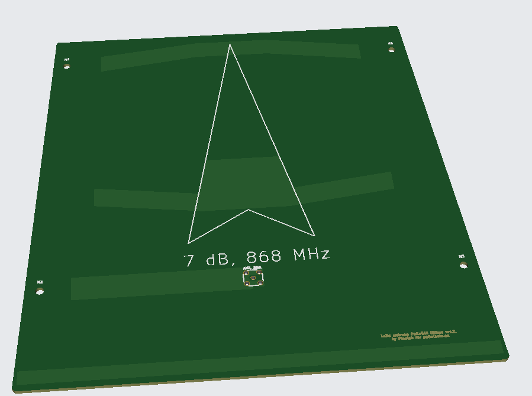
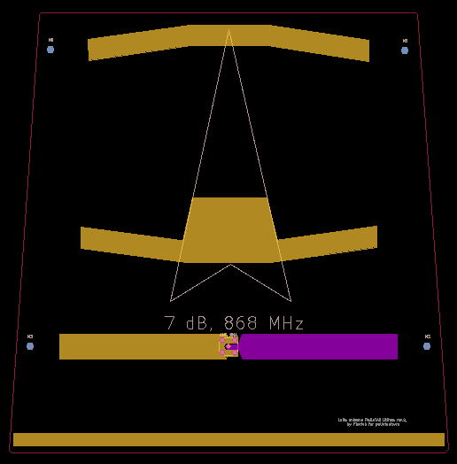

# polluTag Ultima – 868 MHz LoRa PCB Yagi Antenna

A directional PCB Yagi-Uda antenna for **868 MHz LoRa** (EU ISM band), designed for the polluTag project. The whole antenna is etched on a standard PCB, so it can be ordered from any PCB fab directly from the Gerber files in this repository.



## Specifications

| Parameter        | Value                         |
|------------------|-------------------------------|
| Frequency        | 868 MHz (EU868 LoRa band)     |
| Gain             | ~7 dB                         |
| Type             | Yagi-Uda, printed on PCB      |
| Elements         | 1 reflector, 1 driven dipole, 2 directors |
| Polarization     | Linear (parallel to the elements) |
| Connector        | SMA, board-mounted at the feed point |
| Mounting         | 4 × mounting holes (H1–H4)    |

## How it works



From the bottom edge to the top of the board:

1. **Reflector** – the long strip along the bottom edge.
2. **Driven element** – a printed dipole fed by the SMA connector in the middle. One half of the dipole is on the top copper layer, the other half on the bottom layer.
3. **Director 1** – the middle element with the widened center section.
4. **Director 2** – the angled element near the top edge.

The arrow printed on the silkscreen shows the **direction of maximum radiation**. Point the arrow at the gateway (or at the node, if used on the gateway side).

## Usage tips

- Mount the antenna with the elements **in the same orientation as the antenna on the other end** of the link (usually vertical for typical whip antennas – i.e. rotate the board so the elements are vertical).
- Keep metal objects, enclosures and cables away from the element area, especially in front of the antenna.
- Route the coax cable away from the board, ideally perpendicular to the elements, to avoid detuning.
- Use the mounting holes with plastic (nylon) standoffs and screws if possible.

## Manufacturing

The `Gerbers/` folder contains everything needed for fabrication.

- Standard FR-4, 2 layers
- Order the board, solder the SMA edge/PCB-mount connector at the **ANT** footprint, and it's ready to use.
- Note: the tuning depends on board thickness and dielectric constant – stick to the material and thickness the design was made for, or verify with a VNA after manufacturing.

## Repository contents

```
polluTag_Ultima/
├── Gerbers/        # Fabrication files
├── 3d-view.png     # 3D render of the board
├── layout.png      # Copper layout
├── LICENSE
└── README.md
```

## License

See the [LICENSE](LICENSE) file.